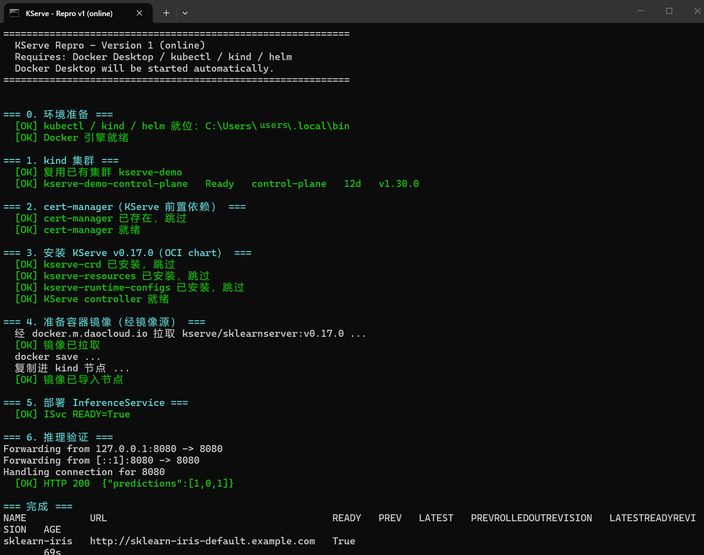
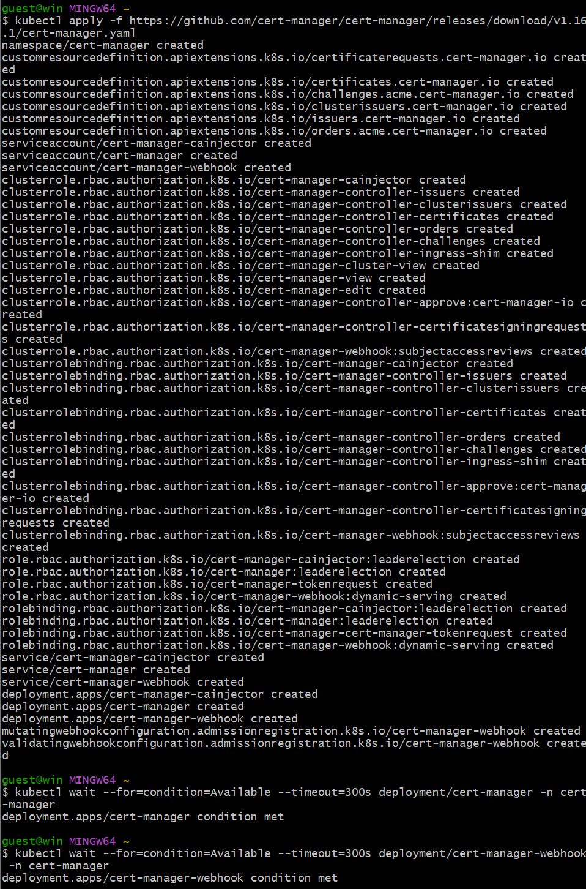

# kserve-local-repro

> 在 Windows 上把 [KServe](https://github.com/kserve/kserve) v0.17.0 从零跑通——
> 从建集群、装依赖，到 `READY=True`，再到真实 HTTP 推理返回 `{"predictions":[1,0,1]}`。
> 两条复现路径、六个必踩的坑，全部固化成脚本。



| 项目 | 内容 |
|---|---|
| **上游** | [kserve/kserve](https://github.com/kserve/kserve) v0.17.0（Apache-2.0） |
| **运行环境** | Windows 10/11 + Docker Desktop（WSL2 后端） |
| **平台版本** | Kubernetes v1.30.0 / kind v0.23.0 / Helm v3.15.2 |
| **模型** | sklearn iris（SVM），`model-v2.joblib` |
| **实测结果** | `ISvc READY=True` + `HTTP 200 {"predictions":[1,0,1]}` |
| **许可** | 本仓库原创内容 MIT；KServe 衍生部分 Apache-2.0（见 [许可与来源](许可与来源/)） |

---

## 一、这是什么

[KServe](https://github.com/kserve/kserve) 是运行在 Kubernetes 上的 **AI 模型服务化平台**，
核心 CRD 叫 `InferenceService`。官方文档的安装步骤是十几条散命令，手工操作时最容易卡在两处：

1. **模型投递失败** → `storage-initializer` 初始化容器反复崩溃 → `READY` 永远不变成 `True`
2. **容器镜像拉不下来** → 国内访问 Docker Hub 被污染 → `ErrImagePull` → 同样卡死

这两处都不是"配置写得对不对"的问题，而是**认知盲区**——协议支持范围、资源投递语义、
镜像源的可达性，每一条都足以让第一次部署的人卡上一天。本仓库把它们固化成了两条可重复执行的脚本。

> **本仓库不是 KServe 的 fork，也不是官方仓库。**
> 它是一份**学习存档**：脚本、笔记、踩坑记录与中间产物全部原创；
> KServe 本身是 GitHub 上的 Apache-2.0 开源项目，按其许可协议使用，副本见 [许可与来源](许可与来源/)。

---

## 二、怎么跑

### 方式 A · 双击（推荐）

资源管理器里双击 **`运行-PS-01-直连复现.cmd`**（直连，全程走公网）或
**`运行-PS-02-离线复现.cmd`**（离线，模型和镜像都走本地）。

### 方式 B · 命令行

```powershell
cd <本仓库根目录>
.\运行-PS-01-直连复现.cmd
# 或
powershell -ExecutionPolicy Bypass -File .\PS-01-直连复现.ps1
```

脚本会自动完成这六步：

```
=== 0. 环境准备 ===        启动 Docker Desktop，等引擎就绪
=== 1. kind 集群 ===        建集群（已内置镜像加速），或复用已有集群
=== 2. cert-manager ===     KServe 前置依赖
=== 3. KServe v0.17.0 ===   OCI chart 装 kserve-crd / resources / runtime-configs
                            + 创建 sklearn ClusterRuntime
=== 4. 容器镜像 ===         经镜像源拉取 → docker save → 导入 kind 节点
=== 5. 部署 ISvc ===         等 READY=True
=== 6. 推理验证 ===          port-forward + POST /v1/models/...:predict
```

成功的样子：

```
  [OK] ISvc READY=True
  [OK] HTTP 200  {"predictions":[1,0,1]}

NAME           URL                                       READY   AGE
sklearn-iris   http://sklearn-iris-default.example.com   True    69s
pod/sklearn-iris-predictor-765f5d85fb-hstnb             1/1     Running
deployment.apps/sklearn-iris-predictor                   1/1     Available
service/sklearn-iris-predictor                           ClusterIP 10.96.151.4
```

`{"predictions":[1,0,1]}` 是鸢尾花数据集的分类结果（setosa / versorsicolor / virginica），正确。

### 版本二 · 离线复现

`运行-PS-02-离线复现.cmd` **全程不连外网**：容器镜像从本地 tar 导入，模型从本地
`model-v2.joblib` 挂进节点走 `pvc://` 直挂、根本不创建 init 容器，推理结果与版本一完全一致。

### 前置依赖

| 工具 | 版本 | 说明 |
|---|---|---|
| Docker Desktop | 任意近期版本 | 官网下载，per-user 安装即可，勾选 WSL2 后端 |
| kubectl | v1.30.0 | `dl.k8s.io` 下载 |
| kind | v0.23.0 | `kind.sigs.k8s.io` 下载 |
| Helm | v3.15.2 | `get.helm.sh` 下载 |

三个 exe 放在 `%USERPROFILE%\.local\bin\` 下最省事（脚本会自动去这里找，找不到退回系统 PATH）。
**WSL 不需要单独装发行版**——Docker Desktop 的 Linux 容器后端自带 WSL2 环境。

---

## 三、目录结构

```
.
├── README.md                    ← 本文件（仓库首页）
├── 运行-PS-01-直连复现.cmd        ← 双击这个（版本一，全程走公网）
├── 运行-PS-02-离线复现.cmd        ← 双击这个（版本二，用本地中间产物）
├── PS-01-直连复现.ps1
├── PS-02-离线复现.ps1
├── LICENSE                     ← 本仓库原创内容的许可（MIT）
├── docs\
│   └── 本地复现指南.md            ← 完整版复现指南（六个坑 / 网络实战 / PowerShell 踩坑 / 许可边界）
├── 中间产物\
│   ├── model-v2.joblib            模型文件（5408 B，鸢尾花 SVM）
│   ├── kind-config-mirror.yaml    建集群用：内置容器镜像加速
│   ├── ctr-hosts.toml             节点 containerd 的 docker.io 加速配置
│   ├── ctr-hosts-quay.toml        节点 containerd 的 quay.io 加速配置
│   ├── apply-ctr-mirror.sh        节点加速配置一键部署脚本
│   ├── sklearn-isvc.yaml          在线版 InferenceService
│   ├── sklearn-isvc-offline.yaml  离线版 InferenceService
│   ├── model-pv-pvc.yaml          离线版用的 PV + PVC
│   └── mirror-test.yaml           镜像加速自测用
├── 笔记\                       全部教程文档（5 篇）
│   ├── 00-PROJECT_OVERVIEW.md
│   ├── 01-零基础跑通KServe-Demo指南.md
│   ├── 01a-环境与集群下载.md
│   ├── 01b-直连跑通.md
│   └── 02-离线模型加载方案.md
├── 截图\                       关键步骤截图
│   ├── 01-全流程跑通.png
│   └── 02-推理结果与资源清单.png
├── image\                      教程内嵌的过程截图（11 张，已脱敏）
└── 许可与来源\
    └── KServe-LICENSE-Apache-2.0.txt
```

---

## 四、六个必踩的坑

全部已在脚本里修掉，完整解释见 [docs/本地复现指南.md](docs/本地复现指南.md)。

| # | 坑 | 一句话解法 |
|---|---|---|
| 1 | `configmap://` 协议 KServe 根本不支持 | 准入阶段就被拒，`Deployment` 都不会创建 |
| 2 | `READY` 显示 `Unknown` 和 `False` 是两回事 | `Unknown` = 准入被拒；`False` = Pod 没起来 |
| 3 | `https://` 模型地址必须指向**真实文件**不能是目录 | `storage-initializer` 只做单文件 GET，目录前缀必 404 |
| 4 | `docker cp` 到 kind 节点 `/tmp` 会"成功但看不见" | `/tmp` 是 tmpfs 挂载，拷到 `/var/lib` 这类真实目录 |
| 5 | `kind load docker-image` 在纯 amd64 机器上失败 | 改 `docker save` → `docker cp` → 节点内 `ctr images import`（不加 `--all-platforms`） |
| 6 | kind 配置里写死 `hostPort` 会撞端口 | 本 demo 走 `kubectl port-forward`，默认不开端口映射 |

还有两条网络实战结论：**Docker Hub 在国内必须配镜像加速**（本包用的是 daocloud / 1ms.run /
1panel.live / hub.rat.dev 等公共加速站，代理的仍是官方镜像、digest 一致）；
**GitHub releases 的 CDN 在国内会被限速到 KB 级**，所以 cert-manager 改走 Helm 官方源而不是下载 YAML。

---

## 五、学习笔记

| 笔记 | 内容 |
|---|---|
| [00-PROJECT_OVERVIEW.md](笔记/00-PROJECT_OVERVIEW.md) | 项目解读：KServe 是什么、架构与能力拆解、能学到什么、面试怎么聊 |
| [01-零基础跑通KServe-Demo指南.md](笔记/01-零基础跑通KServe-Demo指南.md) | 从装 Docker Desktop 到推理跑通，零基础全流程（附截图） |
| [01a-环境与集群下载.md](笔记/01a-环境与集群下载.md) | kind 集群环境准备、镜像/模型资源下载与验证 |
| [01b-直连跑通.md](笔记/01b-直连跑通.md) | 直连复现的完整过程与逐条排错记录 |
| [02-离线模型加载方案.md](笔记/02-离线模型加载方案.md) | 离线（不连外网）加载模型的方案设计 |

---

## 六、参考学习 · dnomd343/kms-server

> **这一节与上面的 KServe 主线没有技术关联**，是另一条独立的学习线索。
> [`dnomd343/kms-server`](https://github.com/dnomd343/kms-server) 是一个 **KMS 激活服务器**
> （Windows / Office 全系列激活），Docker 构建，内置各版本 KMS 密钥，
> 提供网页端与命令行两种密钥检索方式，并有 API 可检查其他 KMS 服务器的工作状态。
> 下面按上游文档梳理其部署要点，作为阅读与动手的参考；**实际使用须在已获授权的环境中进行。**

### 快速部署

```bash
# host 网络：1688 端口用于 KMS 激活，1689 端口用于 HTTP 访问（反向代理）
docker run -d --restart=always --network host dnomd343/kms-server

# bridge 网络
docker run -d --restart=always -p 1688-1689:1688-1689 dnomd343/kms-server
```

镜像同时发布在多个源（国内网络可用阿里云仓库加速）：

```
Docker Hub      : dnomd343/kms-server
Github Package  : ghcr.io/dnomd343/kms-server
阿里云镜像       : registry.cn-shenzhen.aliyuncs.com/dnomd343/kms-server
```

### 运行参数与环境变量

| 命令行参数 | 环境变量 | 说明 |
|---|---|---|
| `--debug` | `DEBUG` | 开启 DEBUG 模式，输出调试日志 |
| `--kms-port` | `KMS_PORT` | KMS 激活端口，默认 `1688` |
| `--http-port` | `HTTP_PORT` | HTTP 服务端口，默认 `1689` |
| `--disable-http` | `DISABLE_HTTP` | 禁用 HTTP 服务，减少多余性能占用 |
| `-v` / `--version` | — | 显示版本信息并退出 |
| `-h` / `--help` | — | 显示帮助信息并退出 |

### 部署流程要点

1. **防火墙检查** —— `1688/tcp` 必须放行，否则外部激活请求打不进来：
   ```bash
   ufw allow 1688/tcp          # ufw
   firewall-cmd --zone=public --add-port=1688/tcp --permanent   # firewalld
   ```
   云服务器还需在服务商控制台的安全组里放行同一端口。
2. **Docker 检查** —— `docker --version` 无输出则先装 Docker。
3. **启动服务** —— 见上方 `docker run`。
4. **配置反向代理** —— 把自有域名解析到服务器，Nginx 反代到本机 `1689/tcp`，并配好证书：
   ```nginx
   server {
       listen 443 ssl http2;
       server_name <your-domain>;
       ssl_certificate     <path>/fullchain.pem;
       ssl_certificate_key <path>/privkey.pem;
       location / { proxy_pass http://127.0.0.1:1689; }
   }
   ```
5. **检查服务是否正常** —— 请求 `/check/<host>:<port>`，返回 `available` 即工作正常。

### 用法速览

激活时在客户端填入自有域名即可；密钥检索走网页或 curl：

```bash
curl <your-domain>              # 输出操作说明
curl <your-domain>/win          # 输出 Windows 的 KMS 密钥
curl <your-domain>/win-server   # 输出 Windows Server 的 KMS 密钥
curl <your-domain>/office       # 输出 Office 激活命令
curl <your-domain>/check/<host>:<port>   # 检查其他 KMS 服务器状态
```

服务端还预留了 JSON 接口（如 `/json` 输出全部 KMS 密钥）便于二次开发。

> ⚠️ **使用边界**：KMS 激活服务器用于向客户端下发批量激活授权。
> 请仅在**已获得软件正版授权**的环境（自有设备、企业批量授权、内部测试）中使用，
> 并遵守软件许可条款与当地法规；对外提供服务或商用前请自行确认合规性。

---

## 七、脱敏与隐私说明

这是一个公开仓库，发布前对包内所有内容做了脱敏处理：

- **截图**：终端提示符、窗口标题栏、面板账号名等个人信息，采用**像素级重绘**替换
  （同字体、同字号、同颜色、同基线），而非简单涂黑；共 11 张过程截图 + 2 张关键步骤截图。
- **文本**：全部笔记中的主机名、用户名统一改为 `<user>@<host>` 占位符，
  不含真实姓名、学校、邮箱、账号等身份信息。
- **IP 地址**：仅保留集群内网地址（kind 节点、Pod、Service）与公开的镜像站地址，无任何内网或个人信息。



---

## 八、许可与署名

### 本仓库的原创内容（MIT）

`LICENSE` 覆盖本仓库的**脚本、笔记、文档与自创中间产物**（`kind-config-mirror.yaml`、
`ctr-hosts*.toml`、`apply-ctr-mirror.sh` 等），可自由使用、修改、再分发。

### KServe 衍生部分（Apache-2.0）

- `model-v2.joblib`：KServe 官方示例模型（鸢尾花 SVM），随 KServe 以 Apache-2.0 发布
- `中间产物\sklearn-isvc*.yaml`：在 KServe 官方样例基础上改写，**已注明修改点**
- KServe 采用 **Apache License 2.0**（副本见 [许可与来源](许可与来源/)），
  再分发时必须保留 LICENSE 并注明做过哪些修改

### 说明

- KServe 源码本身是 GitHub 公开项目，任何人都能 clone——它本身不构成"作品"。
  若用于参赛或作品集，请提交**自己写的部分**（本仓库的脚本与文档、你对 KServe 的扩展、
  或基于它的实验结果），并在使用处注明"基于 KServe v0.17.0"。
- 商业部署请自行确认所用镜像源、模型权重、依赖库的许可条款。

---

## 九、致谢

- **[kserve/kserve](https://github.com/kserve/kserve)** —— 本仓库的主线上游，Apache-2.0
- **[cert-manager/cert-manager](https://github.com/cert-manager/cert-manager)** —— KServe 的前置依赖
- **[dnomd343/kms-server](https://github.com/dnomd343/kms-server)** —— 参考学习的一节（见第六节）
- **[tduffy000/kfserving-uri-examples](https://github.com/tduffy000/kfserving-uri-examples)** —— 可用的模型下载示例
- **[trustyai-explainability/model-collection](https://github.com/trustyai-explainability/model-collection)** —— 模型链接参考

> 本仓库为个人学习存档，与上述任何组织无隶属关系。
