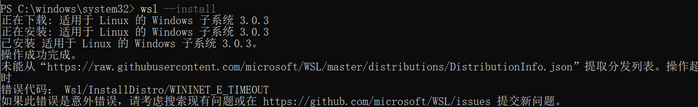
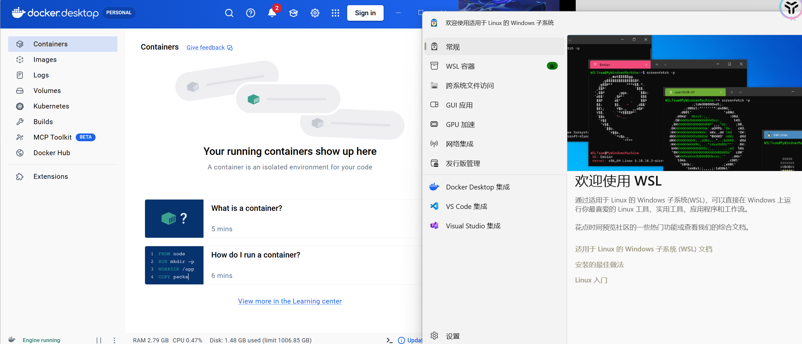
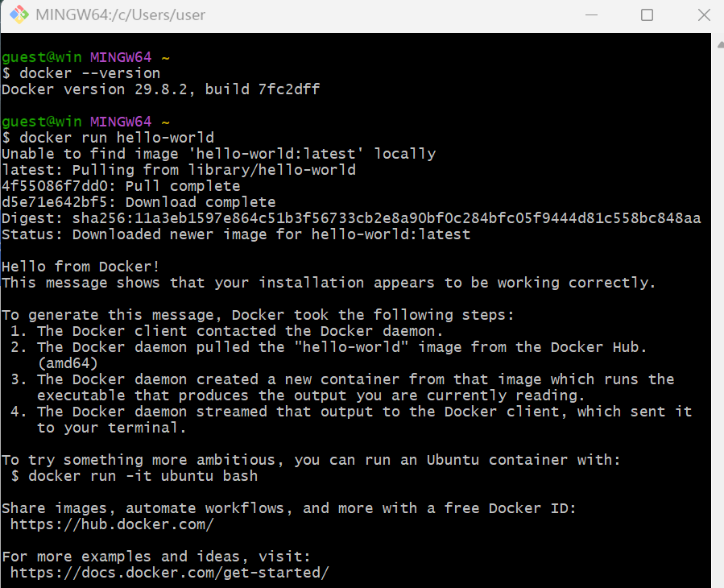
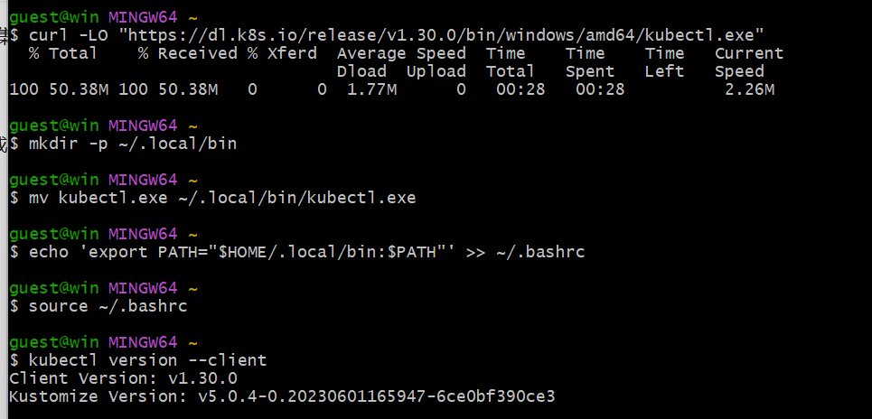
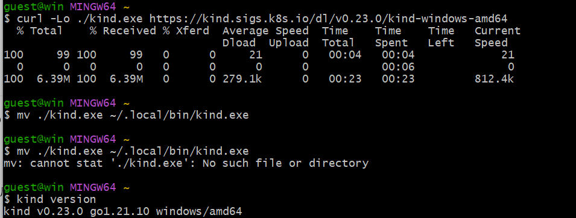
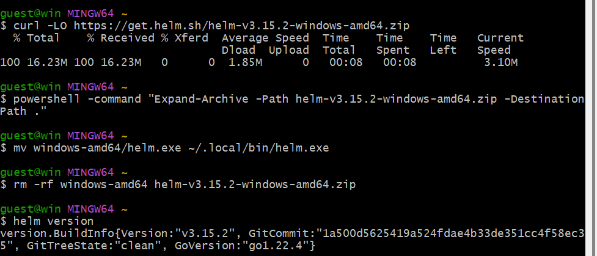
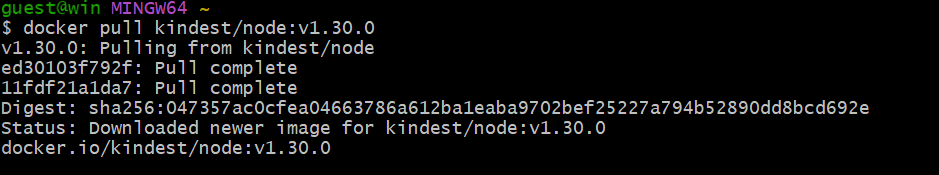
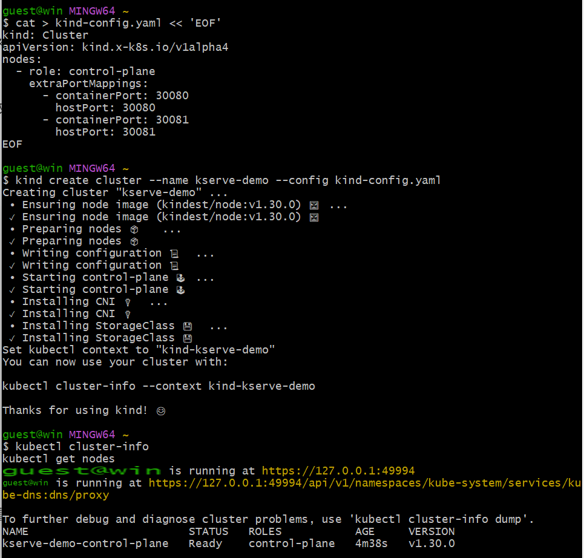
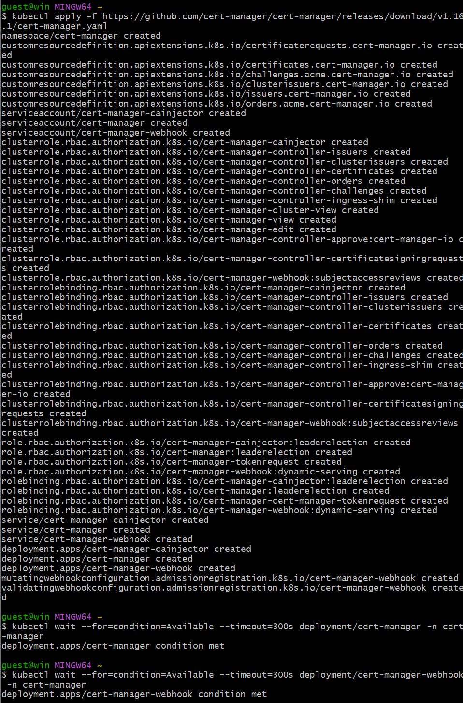

# 零基础跑通 KServe Demo — 完全手册

> 目标：在你 Windows 电脑上，把 KServe 装起来，部署一个 sklearn 模型（或 vLLM 大模型），最终看到 `kubectl get isvc` 输出 Ready。
> 所有命令都在 **Git Bash** 里跑（你已经装好 Git Bash 了）。
> 预计耗时：1-2 小时（其中下载占大头）。

---

## 第 1 部分：先搞懂这些名词（5 分钟）

### 🐳 Docker
**是什么**：把程序 + 它需要的环境打包成一个"镜像"，镜像跑起来叫"容器"。
**类比**：镜像 = 装箱说明书，容器 = 实际跑起来的箱子。
**为啥需要**：KServe 装在 K8s 上，K8s 需要 Docker 跑容器。

### ☸️ Kubernetes（简称 K8s）
**是什么**：管容器的系统。可以自动起停容器、扩缩容、负载均衡。
**类比**：Docker 是"单个集装箱"，K8s 是"整个港口调度系统"。
**基本单位**：
- **Pod** = 1 个或几个紧密协作的容器（最小部署单位）
- **Deployment** = "我想要 N 份一模一样的 Pod"（声明式）
- **Service** = 给 Pod 群一个固定 IP/域名（Pod 死了会换，但 Service 不变）
- **Ingress** = 外部访问入口（域名 + 路径 → 后端 Service）
- **CRD（Custom Resource Definition）** = K8s 自带的资源类型（Pod/Deployment 等）之外的"自定义类型"。KServe 的核心就是定义了 `InferenceService` 这个 CRD。

### 🔧 kubectl
**是什么**：命令行工具，跟 K8s API 对话。"K8s 的遥控器"。
**常用命令**：
- `kubectl get pods` — 看 Pod
- `kubectl apply -f xxx.yaml` — 应用一份配置
- `kubectl logs pod名` — 看 Pod 日志
- `kubectl describe pod pod名` — 看 Pod 详细情况

### 🪆 kind（Kubernetes IN Docker）
**是什么**：一个工具，能在你的电脑里跑一个"本地版 K8s"——这个本地 K8s 跑在 Docker 容器里。
**类比**：你电脑 = 大盒子，里面跑一个 Docker = 小盒子，Docker 里跑 K8s = 更小的盒子。
**为啥需要**：你不用花钱买云服务器，本地就能玩 K8s。

### ⎈ Helm
**是什么**：K8s 的"包管理器"。把一堆 YAML 打成一个包（叫 Chart）一键安装。
**类比**：apt（Ubuntu）/ brew（Mac），但装的是"应用"。
**KServe 提供 Helm Chart**，所以一行命令就能装。

### 🎯 KServe
**是什么**：在 K8s 上部署 AI 模型服务的平台。让你用一行 YAML 就能把模型变成 HTTP 接口。
**核心 CRD**：`InferenceService`（简称 ISvc）

### 📦 InferenceService（ISvc）
**是什么**：KServe 定义的自定义资源。一个 ISvc = 一个模型服务。
**长这样**（YAML）：
```yaml
apiVersion: serving.kserve.io/v1beta1
kind: InferenceService
metadata:
  name: my-model
spec:
  predictor:
    model:
      modelFormat:
        name: sklearn   # 用 sklearn 跑
      storageUri: "s3://bucket/model"  # 模型放哪
```
你说"我要这个模型"，KServe Controller 自动给你起 Deployment、Service、Ingress 等一堆 K8s 资源。

### 🤖 sklearn / vLLM
- **sklearn**：经典机器学习库（分类、回归）。模型小，跑得快。
- **vLLM**：大语言模型推理框架。模型大（几个 GB），要用 GPU。
- **新手建议**：先用 sklearn，成功率 100%。vLLM 需要 NVIDIA GPU，且模型下载麻烦。

---

## 第 2 部分：装前置软件（30-60 分钟，主要是下载）

### 步骤 1：装 Docker Desktop
1. 下载：https://www.docker.com/products/docker-desktop/
2. 安装时勾选 "Use WSL 2 instead of Hyper-V"（如果弹出）
3. 安装完**重启电脑**
4. 打开 DockerDesktop，等右下角图标变绿（whale 不冒汗）
5. 打开 Git Bash 验证：
   ```bash
   docker --version
   docker run hello-world
   ```
   看到 "Hello from Docker!" 就算成功。

> ⚠️ **常见坑**：Docker Desktop 要 Windows 10/11 专业版或家庭版 21H2+。如果是企业版没启用 Hyper-V，需要看错误提示。

5暂时没做
### 步骤 2：启用 WSL 2（如果还没开）
如果 `docker run hello-world` 报错要求启用 WSL：
```powershell
# 在 PowerShell（管理员）里跑：
wsl --install
wsl --set-default-version 2
```
装一个 Linux 发行版（Ubuntu 即可，Microsoft Store 里搜）。

### 步骤 3：装 kubectl
**推荐用 curl 直接下**（Git Bash 里）：
```bash
curl -LO "https://dl.k8s.io/release/v1.30.0/bin/windows/amd64/kubectl.exe"
mkdir -p ~/.local/bin
mv kubectl.exe ~/.local/bin/kubectl.exe
echo 'export PATH="$HOME/.local/bin:$PATH"' >> ~/.bashrc
source ~/.bashrc
```
验证：
```bash
kubectl version --client
```

### 步骤 4：装 kind
```bash
curl -Lo ./kind.exe https://kind.sigs.k8s.io/dl/v0.23.0/kind-windows-amd64
mv ./kind.exe ~/.local/bin/kind.exe
chmod +x ~/.local/bin/kind.exe
```
验证：`kind version`

### 步骤 5：装 Helm
去 https://github.com/helm/helm/releases 下载 `helm-windows-amd64.zip`，解压后把 `helm.exe` 放到 `~/.local/bin/`。
或者用 Chocolatey / scoop：`choco install kubernetes-helm`

验证：`helm version`

---

## 第 3 部分：起一个本地 K8s 集群（10 分钟）

### 步骤 6：用 kind 创建集群
**关键：要把 K8s API 端口映射出来**，否则你电脑访问不到。

```bash
cat > kind-config.yaml << 'EOF'
kind: Cluster
apiVersion: kind.x-k8s.io/v1alpha4
nodes:
  - role: control-plane
    extraPortMappings:
      - containerPort: 30080
        hostPort: 30080
      - containerPort: 30081
        hostPort: 30081
EOF

kind create cluster --name kserve-demo --config kind-config.yaml
```

验证：
```bash
kubectl cluster-info
kubectl get nodes
```
看到 `kind-control-plane` 状态 `Ready` 就算成功。

### 步骤 7：装 Ingress（kind 里默认没有）
我们用最简单的方式 — **不用 Ingress**，让 KServe 用 NodePort。这样减少出错的可能。

---

## 第 4 部分：装 KServe（20 分钟）

> 📌 **重要决策**：KServe 有两种安装模式
> - **Serverless（Knative 模式）**：功能全但复杂，需要 Knative + Istio
> - **Raw Kubernetes 模式**：轻量、够用、不需要 Knative
> 
> **我们选 Raw 模式**，新手最稳。

### 步骤 8：安装 cert-manager（KServe 的前置依赖）
```bash
kubectl apply -f https://github.com/cert-manager/cert-manager/releases/download/v1.16.1/cert-manager.yaml
```
等它跑起来：
```bash
kubectl wait --for=condition=Available --timeout=300s deployment/cert-manager -n cert-manager
kubectl wait --for=condition=Available --timeout=300s deployment/cert-manager-webhook -n cert-manager
```

### 步骤 9：安装 KServe（Raw 模式）
```bash
# 加 helm 仓库
helm repo add kserve https://kserve.github.io/kserve-helm-charts
helm repo update

# 创建 namespace
kubectl create ns kserve

# 安装（用 Raw K8s 模式）
helm install kserve kserve/kserve \
  --namespace kserve \
  --set deployment.mode=RawDeployment
```

等它跑起来（约 2-3 分钟）：
```bash
kubectl get pods -n kserve
```
应该看到 `kserve-controller-manager` 状态 `Running`，`Ready 1/1`。

验证 CRD 装上了：
```bash
kubectl get crd | grep kserve
```
应该看到 `inferenceservices.serving.kserve.io` 等几个。

---

## 第 5 部分：部署一个 sklearn 模型（10 分钟）

### 步骤 10：部署示例 ISvc
```bash
cat > sklearn-isvc.yaml << 'EOF'
apiVersion: serving.kserve.io/v1beta1
kind: InferenceService
metadata:
  name: sklearn-iris
  namespace: default
spec:
  predictor:
    model:
      modelFormat:
        name: sklearn
      runtime: kserve-sklearnserver
      storageUri: "gs://kfserving-samples/models/sklearn/1.0/model"
EOF

kubectl apply -f sklearn-isvc.yaml
```

### 步骤 11：等它跑起来（关键观察）
```bash
# 实时查看状态变化
kubectl get isvc sklearn-iris --watch
```

**你会看到 status 经历这些阶段**（每个阶段 30 秒 - 几 分钟）：

| status.state | 含义 |
|---|---|
| `Pending` | KServe 正在准备资源 |
| `LoadBalancerPending` / `IngressReady` | 在准备网络 |
| `Ready` | ✅ **成功**！可以发请求了 |

如果一直卡某一步，看日志排查：
```bash
kubectl describe isvc sklearn-iris
kubectl logs -n kserve -l control-plane=kserve-controller-manager
```

### 步骤 12：测试推理
把端口转出来：
```bash
kubectl port-forward svc/sklearn-iris-predictor 8080:80
```
新开一个 Git Bash 窗口，发请求：
```bash
curl -X POST http://localhost:8080/v1/models/sklearn-iris:predict \
  -H "Content-Type: application/json" \
  -d '{"instances": [[6.8, 2.8, 4.8, 1.4]]}'
```
返回预测结果（鸢尾花类别）就算成功！

---

## 第 6 部分：截图存档用 🎉

### 必截的图
1. **`kubectl get isvc sklearn-iris`** 输出，看到 `Ready` 状态
   ```bash
   kubectl get isvc sklearn-iris -o wide > isvc-status.txt
   ```
2. **`kubectl get pods -n default`** 看到 sklearn-iris-predictor-xxx Running
3. **Curl 推理返回结果**（证明真的跑通）
4. **整体 namespace 资源**：
   ```bash
   kubectl get all -l serving.kserve.io/inferenceservice=sklearn-iris
   ```

保存成 TXT 或截图都行。项目文档里写：
> "在本地 kind 集群完成 KServe 端到端部署，验证 sklearn 模型从 CRD apply → status Ready → HTTP 推理全流程"

---

## 排错速查表

| 现象 | 原因 | 解决 |
|---|---|---|
| `kubectl` 命令 not found | PATH 没配 | 重新 `source ~/.bashrc`，或用绝对路径 |
| kind 集群创建后 `kubectl get nodes` 连不上 | Docker 没在跑 | 启动 Docker Desktop |
| cert-manager pod 卡 `Pending` | 镜像拉不下来 | 配置镜像加速（Docker Desktop → Settings → Docker Engine） |
| KServe pod `CrashLoopBackOff` | 通常是 webhook 配置问题 | `kubectl logs -n kserve <pod>` 看具体错误 |
| ISvc 一直 `Pending` 不动 | controller 没起来 | `kubectl get pods -n kserve` 看 controller 状态 |
| port-forward 报 connection refused | Pod 没 Ready | 先等 `kubectl get isvc` 显示 Ready |
| 模型下载失败 | 国内网络访问不到 gs:// | 用其他示例模型（见下） |

### 国内可用替代模型（避坑）
```yaml
# 用这个替代步骤 10 的 storageUri
storageUri: "https://github.com/kserve/kserve/raw/master/docs/samples/v1beta1/sklearn/v1.0/model/model.joblib"
```
或者用本地 PVC：
```yaml
storageUri: "pvc://my-model-pvc/model.joblib"
```

---

## 进阶：跑 vLLM（大模型）

> ⚠️ **需要 NVIDIA GPU + 至少 16GB 显存**（如 RTX 4090）。没 GPU 跑不了，只能跑小模型。

如果你有 GPU 且想挑战，参考：https://kserve.github.io/website/docs/getting-started/genai-first-isvc

---

## 推荐练习顺序

1. ✅ **先跑通 sklearn**（成功率 100%，成就感拉满）
2. 跑通后再试 vLLM
3. 都跑通后，看一眼 `kubectl describe isvc` 输出的 Events —— 你会看到 KServe Controller 帮你创建了哪些资源（Deployment、Service、ConfigMap 等）
4. 最后看一眼源码里 `pkg/controller/v1beta1/inferenceservice/components/predictor.go`，对照着 Events 就懂了

---

## 整个流程命令速查卡（粘到 Git Bash 一条条跑）

```bash
# ===== 1. 准备集群 =====
kind create cluster --name kserve-demo --config kind-config.yaml
kubectl get nodes

# ===== 2. 装 cert-manager =====
kubectl apply -f https://github.com/cert-manager/cert-manager/releases/download/v1.16.1/cert-manager.yaml
kubectl wait --for=condition=Available --timeout=300s deployment/cert-manager -n cert-manager

# ===== 3. 装 KServe =====
helm repo add kserve https://kserve.github.io/kserve-helm-charts
helm repo update
kubectl create ns kserve
helm install kserve kserve/kserve --namespace kserve --set deployment.mode=RawDeployment
kubectl get pods -n kserve

# ===== 4. 部署模型 =====
cat > sklearn-isvc.yaml << 'EOF'
apiVersion: serving.kserve.io/v1beta1
kind: InferenceService
metadata:
  name: sklearn-iris
  namespace: default
spec:
  predictor:
    model:
      modelFormat:
        name: sklearn
      runtime: kserve-sklearnserver
      storageUri: "https://github.com/kserve/kserve/raw/master/docs/samples/v1beta1/sklearn/v1.0/model/model.joblib"
EOF
kubectl apply -f sklearn-isvc.yaml
kubectl get isvc sklearn-iris --watch

# ===== 5. 测试 =====
kubectl port-forward svc/sklearn-iris-predictor 8080:80 &
sleep 10
curl -X POST http://localhost:8080/v1/models/sklearn-iris:predict \
  -H "Content-Type: application/json" \
  -d '{"instances": [[6.8, 2.8, 4.8, 1.4]]}'
```

跑完看到结果，就完成"本地 Demo 跑通"这一步了 🎉

---

## 后续清理
```bash
kind delete cluster --name kserve-demo
```

---


> 以上方案实在win11可以完成对吧，应该不会出现wsl外面也需要必须linux的地方吧，你只需回答可以/不行，哪些步骤要修改

  

可以，全部步骤都在 Windows 11 原生环境完成，不需要额外的 Linux。

具体依据：
- Docker Desktop → 跑在 WSL2 里（但你不用直接进 WSL）
- kubectl / kind / helm → 都提供了 Windows 版二进制
- 所有 kubectl apply / helm install / curl 命令在 Git Bash 里直接跑
- 没有需要 apt 或原生 Linux 的步骤

无需修改。


常见问题：
1，
**选择第一个选项：“Per-user installation (Recommended)”。**

你完全不用被教程里“All-users”的安装模式绕进去，针对你的 KServe 教程目标，个人安装是更合适的选择。

### 🎯 为什么选“Per-user”就足够了？

*   **官方推荐与默认选项**：Docker 官方明确指出，`Per-user installation` 是为大多数用户推荐的默认选项，它能满足绝大多数使用场景。
*   **完美支持 WSL 2 后端**：你关心的 **WSL 2** 正是个人安装模式所依赖的默认后端，运行 Linux 容器（KServe 教程的核心）毫无问题。
*   **简化权限，避免麻烦**：个人安装**不需要管理员权限**，安装和更新都在你的用户目录下完成，不会触发 UAC 弹窗，可以省去很多权限相关的排错步骤。

### ⚠️ 关于教程里“All-users”模式的澄清

教程中提到的 `Use WSL 2 instead of Hyper-V` 选项，确实是出现在“All-users”安装模式下的。这可能会让人误以为必须选“All-users”才能用 WSL 2，但事实并非如此：

*   **“All-users”的核心是 Hyper-V 和 Windows 容器**：选择该模式主要是为了使用 **Hyper-V** 后端或运行 **Windows 原生容器**，而不是为了 WSL 2。在“All-users”模式下勾选“Use WSL 2...”，只是在该模式下指定用 WSL 2 替代 Hyper-V 来跑 Linux 容器，但这仍然需要管理员权限。
*   **“Per-user”模式本身就用 WSL 2**：个人安装模式**原生就使用 WSL 2**（或 Docker VMM）作为 Linux 容器后端，并且明确**不支持** Hyper-V 和 Windows 容器。对于你的教程（在 kind 里跑 KServe，全是 Linux 容器），这完全够用。

你的教程全程在 **Git Bash** 和 **kind**（运行 Linux 容器）中操作，不涉及 Windows 原生容器或 Hyper-V。因此，选择 **“Per-user installation”** 是最直接、最清爽的路径。


2，

这个报错很常见，**WSL 的核心组件其实已经装好了**，失败的是最后一步——从 GitHub 拉取可用的 Linux 发行版列表时网络超时了。既然一键安装的路暂时走不通，我们可以手动把 Ubuntu 装上去。[](https://adg.csdn.net/6a2fa05510ee7a33f27d60e9.html)

这里有几种方案，**推荐直接使用方案一**，通常最快捷。

### 🛠️ 解决方案一：用 winget 从微软商店源安装（推荐）

这是最省事的方法，可以绕开 GitHub，直接从微软的 CDN 获取 Ubuntu。

1. 在**管理员 PowerShell** 中，执行以下命令：
    
    powershell
    
    winget install -e --id Canonical.Ubuntu.2204
    
    > **说明**：这个命令会从微软商店源直接安装 Ubuntu 22.04，如果网络对商店 CDN 友好，通常能很快完成。[](https://adg.csdn.net/6a2fa05510ee7a33f27d60e9.html)
    
1. 安装完成后，在 PowerShell 中输入 `wsl -l -v` 验证，看到 `Ubuntu-22.04` 且状态正常即可。


### ✅ 安装完成后的收尾工作

无论用哪种方式装好 Ubuntu，都建议执行以下命令，确保 Docker 能正常工作：

1. **设置默认版本**：在 PowerShell 中执行，确保新装的 Linux 使用 WSL 2。
    
    powershell
    
    wsl --set-default-version 2
    
2. **重启电脑**：这是一个关键步骤，让之前的系统更改彻底生效。
    
3. **启动 Docker Desktop**：重启后打开 Docker，观察右下角小鲸鱼图标是否变绿，不再报错，就说明环境准备好了。


3，

- **左侧 Docker Desktop 界面**：左下角显示 **“Engine running”**（引擎正在运行），绿色小图标亮起，说明 Docker 的核心服务已经完美启动，不再报错了。
    
- **右侧 WSL 设置界面**：这是 Windows 自带的 WSL 配置界面，说明 WSL 2 已经彻底安装成功并能正常工作。里面甚至显示了你可能安装的其他 Linux 发行版（图里的 Debian、Ubuntu、Kali）。
    
- **结论**：环境已经完全就绪，可以开始验证并往下走了。


4，**完美！** 🎉 看到 `Hello from Docker!` 这一大段输出，说明你的 Docker 引擎、WSL 2 后端以及 Git Bash 之间的通信已经**彻底打通**了。而且你的网络非常给力，拉取 `hello-world` 镜像没有遇到任何超时，直接下载成功了。



5，**目前进度总结**：  
✅ 步骤 3：kubectl 已装好 (v1.30.0)  
✅ 步骤 4：kind 已装好 (v0.23.0)






**太丝滑了！** 🎉 你的网络环境和动手能力都很棒。

- 第一张图：`helm version` 成功输出 `v3.15.2`，**Helm 安装通关**。
- 第二张图：`kindest/node:v1.30.0` 镜像成功拉取，**K8s 底层节点镜像准备完毕**。
到这里，你所有的前置工具（Docker、kubectl、kind、Helm）和底层镜像都已经完全就绪了。接下来，正式进入教程的 **第 3 部分：起一个本地 K8s 集群**。






6创建 kind 集群配置文件之前我先问一下，如果不是当前git终端，而是新开的，需要补以上哪些命令步骤？

如果你新开一个 Git Bash 终端，**不需要重新下载或安装任何工具**，因为所有的可执行文件都已经永久保存在你的电脑里了。

新开终端只需要补充执行以下几条命令（主要是为了激活环境和确保在正确的目录）：

```bash
# 1. 确保 PATH 环境变量生效（加载你之前写入的配置）
source ~/.bashrc

# 2. 切换到你刚才存下载文件和准备创建 yaml 的目录（如果你新终端默认不在这个目录）
# 例如：cd ~ 或 cd 你之前所在的路径

# 3. （可选）快速验证一下三个工具在新终端里是否正常
kubectl version --client
kind version
helm version
```

**另外两个不需要敲命令行，但必须注意的点：**
1. 确保你的 **Docker Desktop 正在后台运行**（右下角鲸鱼图标是绿色的）。
2. 刚才下载的 `kindest/node:v1.30.0` 镜像已经存在 Docker 里了，新终端**不需要**重新 `docker pull`。


7，**太完美了！** 🎉 `kserve-demo-control-plane` 状态显示为 **`Ready`**，并且版本是 `v1.30.0`。这说明你的本地 Kubernetes 集群已经100%健康运行了。




8，
**非常顺利！** 🎉

看到两个 `condition met`，说明 `cert-manager` 的核心组件和 Webhook 已经完全就绪。你的网络环境简直完美，一点没卡。

现在，前置依赖搞定了，马上进入 **第 4 部分的最后一步：安装 KServe（步骤 9）**。



