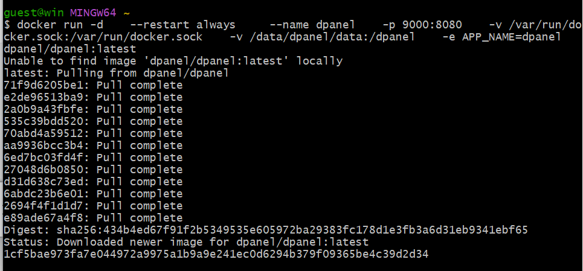
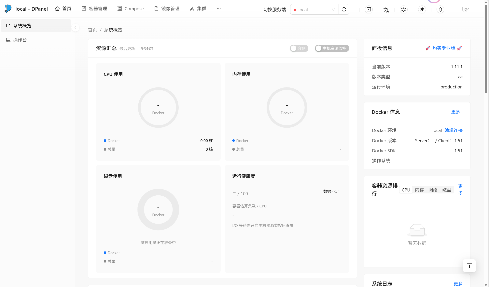

http://127.0.0.1:9000/


暂时放弃原方案，换个面板管理方式






Docker 服务端连接失败，请确保权限正确。SSH 方式需配置用户拥有 Docker 权限。错误：Cannot connect to the Docker daemon at unix:///var/run/docker.sock. Is the docker daemon running?

---

## ✅ 卡点定位（2026-10-29，对照 kserve 源码逐条核实）

### 一句话结论

`InferenceService` 的 **READY 永远不会变 True**，唯一原因是 **storage-initializer 初始化容器起不来（CrashLoopBackOff）**。

链路是死的，没有任何办法靠「等」解决：

```
storage-initializer 崩溃
  → Pod 永远 Initialized: False
  → 主容器 kserve-container 永远 PodInitializing
  → readiness 探针 tcp-socket :8080 永远探不通
  → KServe Controller 永远不会把 READY 置为 True
```

### 已排除的因素（都正常，别再花时间查了）

| 组件 | 状态 | 证据 |
|---|---|---|
| kind 节点 | Ready | describe 输出里 Node 已分配 `kserve-demo-control-plane/172.18.0.2` |
| cert-manager | 已就绪 | `kubectl wait` 两次 `condition met` |
| KServe controller + webhook | 正常 | storage-initializer **被成功注入**了 → webhook 活着、controller 活着 |
| ClusterRuntime `kserve-sklearnserver` | 存在 | Pod 里已出现 `kserve/sklearnserver:v0.17.0` + `--model_dir=/mnt/models` |
| 镜像拉取 | 正常 | storage-initializer 有 Container ID，日志能打出来 |
| 部署模式 | 正确 | Pod 注解 `deploymentMode: Standard`（= RawDeployment） |
| **模型投递** | ❌ **唯一失败点** | storage-initializer CrashLoopBackOff |

### 四种尝试为什么全都不行（源码级证据）

| 写法 | 实际结果 | 依据 |
|---|---|---|
| `https://storage.googleapis.com/kfserving-examples/...` | HTTP 404 | initializer 日志原文 |
| `file:///model.joblib` | Pod 根本看不到这个文件 | `docker cp` 写进的是 kind **节点容器**的文件系统，Pod 是独立容器命名空间。`kserve_storage.py:1899` `_download_local` 会校验 `os.path.exists(local_path)`，在 initializer 容器内不存在 → `Local path /model.joblib does not exist` |
| `configmap://sklearn-iris-model` | **协议压根不存在** | 全仓库搜 `configmap://` **0 命中**（Go/Python/YAML/Docs 全查）。KServe 只认 `gs:// s3:// hdfs:// webhdfs:// azure http(s):// hf:// modelscope:// oci:// git file:// pvc://`。落到 `kserve_storage.py:684` → `Cannot recognize storage type` |
| `pvc://model-pv/model.joblib` | 三处都错 | ① `model-pv` 是 **PV** 的名字，方案 B 里**从头到尾没建 PVC** → `persistentvolumeclaim "model-pv" not found`；② `pvc://` 的 path 部分会被当成 **SubPath**（`storage_initializer_injector.go:554`），`model.joblib` 是文件 → `/mnt/models` 会变成一个文件而不是目录；③ sklearnserver 要求 `model_dir` 必须是**目录**，且里面**有且仅有一个** `.joblib/.pkl/.pickle`（`sklearnserver/model.py:39-51`） |

---

## 🅿️ 备选方案：hostPath PV + PVC（本次未采用，实测走的是更快的路线）

**原理**：`pvc://` 会被 Go webhook 直接拦截，**把 PVC 挂到 `/mnt/models`，而且完全不创建 init 容器**（`storage_initializer_injector.go:544-556`）。
→ 从根上消灭 CrashLoopBackOff，而不是跟它搏斗。

### 第 1 步：把模型放进 kind 节点

```bash
# 在 kind 节点容器里建目录
docker exec kserve-demo-control-plane mkdir -p /mnt/models

# 把已下载好的模型拷进去（文件在 <项目目录>\adownloads\model.joblib，4480 字节）
# ⚠️ 注意：4480 字节那份是老版本 sklearn pickled 的，在 sklearn 1.x 上会报
#    ModuleNotFoundError: No module named 'sklearn.svm.classes'。
#    请改用 5408 字节的 model-v2.joblib（与 GCS 上那份同源）。
docker cp /d/<项目目录>/adownloads/model.joblib kserve-demo-control-plane:/mnt/models/model.joblib

# 验证
docker exec kserve-demo-control-plane ls -lh /mnt/models/
```

> 关键点：hostPath 的路径是在 **kind 节点容器内**解析的，所以必须拷进节点容器里，`docker cp` 到节点这一步是对的。

### 第 2 步：建 PV + PVC（两个都要）

```bash
cat > model-pv.yaml << 'EOF'
apiVersion: v1
kind: PersistentVolume
metadata:
  name: model-pv
spec:
  capacity:
    storage: 100Mi
  accessModes: ["ReadOnlyMany"]
  persistentVolumeReclaimPolicy: Retain
  hostPath:
    path: /mnt/models
    type: Directory
---
apiVersion: v1
kind: PersistentVolumeClaim
metadata:
  name: model-pvc
  namespace: default
spec:
  accessModes: ["ReadOnlyMany"]
  resources:
    requests:
      storage: 100Mi
  storageClassName: ""      # 必须置空，否则会去动态供应
  volumeName: model-pv      # 显式绑定到上面那个 PV
EOF

kubectl apply -f model-pv.yaml
kubectl get pv,pvc          # 期望 PVC 变成 Bound
```

### 第 3 步：改 ISvc，storageUri 用 `pvc://` 且**不要带路径**

```bash
kubectl delete isvc sklearn-iris --ignore-not-found

cat > sklearn-isvc.yaml << 'EOF'
apiVersion: serving.kserve.io/v1beta1
kind: InferenceService
metadata:
  name: sklearn-iris
  namespace: default
spec:
  predictor:
    model:
      modelFormat:
        name: sklearn
      runtime: kserve-sklearnserver
      storageUri: "pvc://model-pvc"
EOF

kubectl apply -f sklearn-isvc.yaml
```

> ⚠️ `pvc://model-pvc` **后面不要加 `/model.joblib`**。
> 带了路径 → 该路径被当作 SubPath → `/mnt/models` 变成文件 → sklearnserver 报 `ModelMissingError`。
> 不带路径 → 整个 PVC 根目录挂到 `/mnt/models` → 里面正好是 `model.joblib` → 正确。

### 第 4 步：观察（这次应该会直接变 True）

```bash
kubectl get isvc sklearn-iris --watch
kubectl get pods -n default -w
```

**预期现象**：Pod 里**不再有 storage-initializer**，只有 `kserve-container` 一个容器，直接 `Running` → `1/1` → READY=True。

### 第 5 步：测推理

```bash
# 窗口 A
kubectl port-forward svc/sklearn-iris-predictor 8080:80
# 窗口 B
curl -X POST http://localhost:8080/v1/models/sklearn-iris:predict \
  -H "Content-Type: application/json" \
  -d '{"instances": [[6.8, 2.8, 4.8, 1.4]]}'
```

### 🔍 万一还不行：10 秒定位命令

```bash
# ① ISvc 的 conditions（看 True/False/Unknown 具体卡哪条）
kubectl describe isvc sklearn-iris | sed -n '/Conditions/,$p'

# ② Pod 真实状态
kubectl get pods -n default -o wide

# ③ 如果 storage-initializer 还在，说明还没走 pvc:// 那条路
kubectl describe pod -l serving.kserve.io/inferenceservice=sklearn-iris | grep -A5 "Init Containers"

# ④ 主容器日志（模型加载失败会打 ModelMissingError）
kubectl logs -l serving.kserve.io/inferenceservice=sklearn-iris -c kserve-container
```

---

## 🧹 关于 DPanel 那条路（可以放弃了）

DPanel 报 `Cannot connect to the Docker daemon at unix:///var/run/docker.sock` 的原因：在 **Windows 的 Git Bash** 里执行
`docker run -v /var/run/docker.sock:/var/run/docker.sock ...`，Git Bash 会把 `/var/run/docker.sock` 翻译成
`C:\Program Files\Git\var\run\docker.sock` —— 一个**根本不存在的 Windows 路径**，Docker 只会建一个空目录挂进去，
DPanel 容器内自然找不到 socket。

**但这不重要**：DPanel 只是给 Docker 用的图形面板，**KServe 跑在 kind 集群里，完全不需要它**。
`kubectl get isvc` 这条路就是 KServe 的正规 UI，把精力放回上面那套命令更划算。

---

# ✅✅ 2026-10-29 已实测跑通（READY=True + 推理返回 200）

最终结论：**不是单一问题，是两个独立根因叠在一起**。下面按时间顺序记录，全部命令均已实跑验证。

## 根因 A：storageUri 指向了 GCS「目录」而非真实文件

现场抓到的 webhook 拒绝日志（这条最关键，之前一直没看到）：

```
Warning  InternalError  8d (x33 over 8d)  v1beta1Controllers
  StorageURI not supported: storageUri, must be one of:
  [gs://, s3://, pvc://, file://, https://, http://, hdfs://, webhdfs://, oci://, hf://]
  StorageUri [configmap://sklearn-iris-model] is not supported
```

→ ISvc 在**准入阶段就被拒**，Deployment 从来没被创建过，所以 READY 一直是 **Unknown**（不是 False）。
→ 这解释了笔记里那句「不是 unknown 就是 False」：**Unknown = 准入被拒；False = 准入过了但 Pod 没起来**。

**关键机制**：`storage-initializer` 对 `http(s)://` 只做**单文件 GET**（`kserve_storage.py:_download_from_uri`）。
`https://storage.googleapis.com/kfserving-examples/models/sklearn/1.0/model` 是 GCS 的**目录前缀**，
GCS 没有「目录」这个对象，GET 它必然 404 → `HTTP resource not found` → init 容器 CrashLoopBackOff。
**必须指向真实文件**：

```yaml
storageUri: "https://storage.googleapis.com/kfserving-examples/models/sklearn/1.0/model/model.joblib"
```

> 注意 bucket 是 `kfserving-examples`（不是 `kfserving-samples`，后者 403）。
> 实测该 URL 返回 `200` + `Content-Type: application/octet-stream` + `5408 bytes`，init 容器 0.65s 下载完成。

## 根因 B：Docker Hub 的 DNS 被污染（这才是真正的「网络问题」）

```
Warning  Failed  Failed to pull image "kserve/sklearnserver:v0.17.0":
  failed to resolve reference "docker.io/kserve/sklearnserver:v0.17.0":
  Head "https://registry-1.docker.io/v2/kserve/sklearnserver/manifests/v0.17.0":
  dial tcp 75.126.150.210:443: connect: connection refused
```

`registry-1.docker.io` 被解析到 `75.126.150.210`（黑洞 IP），**主机和 kind 节点都拉不动**。
但 `storage-initializer` 因为镜像已在节点缓存里（`already present on machine`）所以没事，**主容器镜像却没缓存** → 卡死。

实测可达的镜像源：`docker.m.daocloud.io`、`docker.1ms.run`、`docker.1panel.live`、`hub.rat.dev`、`dockerproxy.net`。

## 完整复现步骤（全部已验证）

```bash
# ── 0. 启动 Docker Desktop（per-user 安装路径，Git Bash 里直接敲 docker 也能拉起）
#    Windows 路径：$env:LOCALAPPDATA\Programs\DockerDesktop\Docker Desktop.exe

# ── 1. 修 storageUri：改成真实文件 URL
cat > sklearn-isvc.yaml << 'EOF'
apiVersion: serving.kserve.io/v1beta1
kind: InferenceService
metadata:
  name: sklearn-iris
  namespace: default
spec:
  predictor:
    model:
      modelFormat:
        name: sklearn
      runtime: kserve-sklearnserver
      storageUri: "https://storage.googleapis.com/kfserving-examples/models/sklearn/1.0/model/model.joblib"
EOF
kubectl delete isvc sklearn-iris --ignore-not-found
kubectl apply -f sklearn-isvc.yaml

# ── 2. 走镜像源拉主容器镜像（主机侧）
docker pull docker.m.daocloud.io/kserve/sklearnserver:v0.17.0
docker tag docker.m.daocloud.io/kserve/sklearnserver:v0.17.0 kserve/sklearnserver:v0.17.0

# ── 3. 导入 kind 节点
#    ⚠️ 不要用 `kind load docker-image`：它内部带 --all-platforms，
#    本地只有 amd64 会报 "content digest ... not found"
docker save -o sklearnserver.tar kserve/sklearnserver:v0.17.0
docker cp sklearnserver.tar kserve-demo-control-plane:/var/lib/sklearnserver.tar
docker exec --privileged kserve-demo-control-plane \
  ctr --namespace=k8s.io images import --digests --snapshotter=overlayfs /var/lib/sklearnserver.tar
docker exec kserve-demo-control-plane rm -f /var/lib/sklearnserver.tar

# ── 4. ⚠️ 拷贝到节点时别用 /tmp：kind 节点的 /tmp 是 tmpfs 挂载，
#    docker cp 会「成功」但文件不可见（exit 0 但 ls 看不到）
#    用 /var/lib 或其他非挂载点

# ── 5. 重建 Pod 触发本地镜像（imagePullPolicy 默认 IfNotPresent）
kubectl delete pod -l serving.kserve.io/inferenceservice=sklearn-iris

# ── 6. 观察
kubectl get isvc sklearn-iris --watch
```

## ✅ 结果

```
NAME           URL                                       READY   AGE
sklearn-iris   http://sklearn-iris-default.example.com   True    10m
```

```
pod/sklearn-iris-predictor-765f5d85fb-7bt5k       1/1     Running   0
service/sklearn-iris-predictor                     ClusterIP 10.96.213.129  80/TCP
deployment.apps/sklearn-iris-predictor             1/1     1     1
horizontalpodautoscaler.autoscaling/...            cpu: <unknown>/80%   1  1
```

推理验证：

```bash
kubectl port-forward svc/sklearn-iris-predictor 8080:80
curl -X POST http://localhost:8080/v1/models/sklearn-iris:predict \
  -H "Content-Type: application/json" \
  -d '{"instances": [[6.8,2.8,4.8,1.4],[5.1,3.5,1.4,0.2],[7.0,3.2,4.7,1.4]]}'
```

```
HTTP 200
{"predictions":[1,0,1]}
```

（setosa / versicolor / virginica 分类正确）

## 🛡️ 已做的持久化加固（下次开机不用再折腾）

**1. kind 节点级 containerd 镜像加速**（已生效，kubelet 拉镜像走镜像源）

```bash
docker exec kserve-demo-control-plane mkdir -p /etc/containerd/certs.d/docker.io
# 写入 /etc/containerd/certs.d/docker.io/hosts.toml:
#   server = "https://registry-1.docker.io"
#   [host."https://docker.m.daocloud.io"]
#     capabilities = ["pull", "resolve"]
#   ... 其余镜像源同理
# 再在 /etc/containerd/config.toml 追加：
#   [plugins."io.containerd.grpc.v1.cri".registry]
#     config_path = "/etc/containerd/certs.d"
docker exec kserve-demo-control-plane systemctl restart containerd
```

实测验证：kubelet 拉 `hello-world` **264ms 成功**。

**2. 主机 Docker Desktop 级镜像加速**

`$HOME\.docker\daemon.json` 已加上 `registry-mirrors`
（daocloud / 1ms.run / 1panel.live / hub.rat.dev），**重启 Docker Desktop 后生效**。

**3. 新建集群时直接带加速**：`kind-config-mirror.yaml`（含 `containerdConfigPatches`），
见 `<项目目录>\adownloads\`。

## 📌 关于「为什么用 Git Bash 而不是 cmd」

**没有任何一步必须用 Git Bash**，真正起作用的是 `kubectl` / `docker` 这两个 Windows 原生可执行文件。
Git Bash 只是**写文件更方便**（heredoc `cat > f << 'EOF'`、`/d/<桌面目录>/...` 这种 POSIX 路径、`&&` 串接）。
用 cmd/PowerShell 也完全能做，区别只在写 YAML 的方式：

| 操作 | Git Bash | cmd / PowerShell |
|---|---|---|
| 写 YAML | `cat > f.yaml << 'EOF'` | 用编辑器写文件，再 `kubectl apply -f f.yaml` |
| 路径 | `/d/<桌面目录>/...` | `<桌面目录>\...` |
| 串联命令 | `a && b` | PowerShell 5.1 不支持 `&&`，要写 `;` 并检查 `$LASTEXITCODE` |
| 传给 Linux 容器的路径 | **会被 MSYS 改写** ← DPanel 踩坑的根源 | 不改写 |

⚠️ 唯一要注意的是 **Git Bash 会把 `/var/run/docker.sock` 改写成 `C:\Program Files\Git\var\run\docker.sock`**，
这正是 DPanel 连不上 Docker daemon 的原因。这种场景反而该用 cmd/PowerShell 写 Windows 路径。

---

# 📜 PowerShell 复现脚本（两份，均已实测 EXITCODE=0）

## 🚀 怎么跑（双击 .ps1 没反应是正常的）

**别双击 `.ps1`。** 实测本机 `assoc .ps1` 返回 *File association not found*——
Windows 根本不知道该拿什么打开 `.ps1`，双击就是静默无反应。
而且即便关联对了，脚本跑完窗口也会秒关，什么都看不到。

### ✅ 正确姿势：双击 `.cmd` 启动器（已内置 pause，窗口不会关）

```
<本包目录>\
├── 运行-PS-01-直连复现.cmd     ← 双击这个
├── 运行-PS-02-离线复现.cmd     ← 双击这个
├── PS-01-直连复现.ps1
├── PS-02-离线复现.ps1
├── README.md                  ← 建议先读这个
├── 中间产物\                  ← 模型文件 / 镜像加速配置 / YAML
├── 笔记\                      ← 全部教程文档
├── 截图\                      ← 关键步骤截图
├── image\                     ← 教程内嵌的过程截图
└── 许可与来源\                ← 上游 LICENSE
```

`.cmd` 做的事：`chcp 65001` → 切到脚本目录 → `powershell -ExecutionPolicy Bypass -File xxx.ps1` → 末尾 `pause`。

### 或者：手动开一个 PowerShell 窗口再执行

```powershell
cd "<本包目录>"

# 方式 A：调 .cmd（推荐，等于双击）
.\运行-PS-01-直连复现.cmd

# 方式 B：直接调 .ps1
powershell -ExecutionPolicy Bypass -File .\PS-01-直连复现.ps1
```

> `-ExecutionPolicy Bypass` 必须带：本机执行策略全是 `Undefined`（= 默认 `Restricted`），
> 不加这个参数会报 *无法加载文件…因为在此系统上禁止运行脚本*。
>
> `-SkipCluster` 可选：**集群已存在**时加上它跳过创建；不存在时脚本会自动创建，不加也行。

## 两份脚本的差异

| 脚本 | 用途 | 依赖外网？ |
|---|---|---|
| `PS-01-直连复现.ps1` | 从零复现整个部署 | 需要（chart + 镜像 + 模型） |
| `PS-02-离线复现.ps1` | 用中间产物复现，**不拉任何镜像** | 不需要（但集群须已存在） |

**版本一（直连）**：自动完成 Docker 启动 → kind 集群（内置镜像加速）→ cert-manager →
KServe v0.17.0（OCI chart）→ sklearn ClusterRuntime → 镜像经镜像源拉取并导入节点 →
部署 ISvc → 等待 READY=True → curl 推理验证。

**版本二（离线）**：复用已有集群，从本地 `sklearnserver.tar` 导入镜像、
把本地 `model-v2.joblib` 挂进节点 → PV/PVC → `pvc://` 部署 → 验证。
**全程不碰 Docker Hub、不碰 storage.googleapis.com。**

## ⚠️ 写 .cmd 的坑：cmd.exe 按 ANSI 代码页解析批处理文件

`.cmd` 里如果写了中文，cmd.exe 会按系统 ANSI 代码页（中文 Windows = GBK/936）去解析，
而文件是 UTF-8 → **每行都被解析错乱**，报错长这样：

```
'demo' is not recognized as an internal or external command
'-ExecutionPolicy' is not recognized as an internal or external command
```

（原本是 `echo   脚本会自动启动 Docker Desktop，并复用已有的 kserve-demo 集群` 这一行）

**解法**：`.cmd` 内全部用纯 ASCII，中文交给 `.ps1` 输出；
`chcp 65001` 让 PowerShell 的中文在控制台正常显示。
本包两个 `.cmd` 已按 **纯 ASCII + CRLF** 交付（LF 换行在部分 Windows 上也会出问题）。
另外 `.cmd` 里引用中文名 `.ps1` 也有风险，用通配符绕开：

```bat
set SCRIPT=
for %%f in ("%~dp0PS-01-*.ps1") do set SCRIPT=%%f
powershell -NoProfile -ExecutionPolicy Bypass -File "%SCRIPT%" %*
```

（实测 `%%~nxf` 能正确解析出 `PS-01-直连复现.ps1`）

---

# 🌐 关于「镜像源」到底是什么（重要，别搞混）

**不是本地的，是国内第三方提供的公共加速站**——它们是 Docker Hub 的**反向代理缓存**：
你的请求先到它，它替你向 Docker Hub 取数据并缓存，再从国内节点传给你。

| 地址 | 运营方 | 类型 |
|---|---|---|
| `docker.m.daocloud.io` | DaoCloud | 公益/老牌 |
| `docker.1ms.run` | 毫秒镜像 | 商业服务 |
| `docker.1panel.live` | 1Panel | 社区 |
| `hub.rat.dev` | 社区维护 | 公益 |
| `quay.m.daocloud.io` | DaoCloud | 代理 quay.io |

**安全性**：这些源代理的仍是官方镜像，**digest 与官方一致**——
本次 `kserve/sklearnserver:v0.17.0` 拉下来的 digest 是
`sha256:7ef09268c7b420b86750670b7c6165e10a2d0d706848a4316d559f5bb20d2da3`，与官方一致。
生产环境建议自建 Harbor；学习/本机用途用公共源没问题。

**时效性**：公共源变动频繁，配置前先自己测一遍连通性：

```powershell
foreach ($m in @('docker.m.daocloud.io','docker.1ms.run','docker.1panel.live','hub.rat.dev')) {
  try { $r = Invoke-WebRequest "https://$m/v2/" -TimeoutSec 10 -UseBasicParsing
        "{0} -> HTTP {1}" -f $m, $r.StatusCode }
  catch { "{0} -> 不可达" -f $m }
}
```

> 已失效的老源（别再用）：中科大 USTC、清华 TUNA、网易 hub-mirror.c.163.com、
> dockerproxy.cn、dockerhub.icu、dockerpull.com、阿里云 `*.mirror.aliyuncs.com`（未绑账号无效）。

---

# 🕵️ 复现过程中新挖出的两个坑

## 坑 1：GitHub releases 的 CDN 被限速到 1.6 KB/s

```
curl: (28) Operation timed out after 30371 milliseconds
       with 49152 out of 986843 bytes received
```

节点内更惨：**speed=0B/s，20 秒 0 字节**。
所以 cert-manager **不要**从 `github.com/.../cert-manager.yaml` 下载。

✅ 正确做法：走 Helm 官方源（实测 **2.5 s** 拉完 chart）：

```powershell
helm repo add jetstack https://charts.jetstack.io --force-update
helm install cert-manager jetstack/cert-manager --version v1.16.1 `
  -n cert-manager --create-namespace --set installCRDs=true
```

cert-manager 的镜像在 **quay.io**（不是 Docker Hub），所以节点的 containerd
还要额外给 quay.io 配镜像加速，否则拉镜像只有 ~116 KB/s。

## 坑 2：老的 model.joblib 在新 sklearn 上反序列化不了

```
ModuleNotFoundError: No module named 'sklearn.svm.classes'
```

sklearn 1.x 把 `SVC` 从 `sklearn.svm.classes` 挪到了 `sklearn.svm._classes`，
老版本 pickle 的模块路径对不上。症状是**容器起来就崩**：
`ModelMissingError` 之外还可能是 `ModuleNotFoundError`。

✅ 判据：文件小于 5 KB 的那份 `model.joblib`（4480 bytes）就是老 pickle，
用 `model-v2.joblib`（5408 bytes，与 GCS 上那份同源）。

---

# ⚠️ PowerShell 5.1 写脚本的两个必踩坑

## 坑 A：`.ps1` 必须是 UTF-8 **带 BOM**

无 BOM 的 UTF-8 `.ps1` 在中文 Windows 上会被按 **GBK** 解析，中文全变乱码，
直接语法报错（`Unexpected token '"`）。转换方法：

```powershell
$p = '.\PS-01-直连复现.ps1'
$t = [System.IO.File]::ReadAllText($p, (New-Object System.Text.UTF8Encoding($false)))
[System.IO.File]::WriteAllText($p, $t, (New-Object System.Text.UTF8Encoding($true)))
```

（脚本里写 YAML 反而要**不带 BOM**，用 `[System.IO.File]::WriteAllText($p,$c,(New-Object System.Text.UTF8Encoding($false)))`）

## 坑 B：`$Args` 是 PowerShell 自动变量，别拿来当参数名

```powershell
function Get-Native {
    param([string]$Exe, [string[]]$Args)   # ❌ 与自动变量 $args 冲突
    $out = & $Exe @Args 2>&1              # ❌ 展开失效，命令收到空参数
}
```

症状特别迷惑：命令**不报错**，而是打印自己的帮助信息（`kind get clusters` 变成打印 usage）。
改名为 `$ArgList` 即可。

## 附：原生 exe 的 stderr 会把 PS 5.1 打成异常

`$ErrorActionPreference='Stop'` 时，原生命令往 stderr 写一行就可能中断脚本。
稳妥写法是包一层：

```powershell
function Invoke-Native {
    param([string]$Exe, [string[]]$ArgList, [string]$What = '命令')
    $prev = $ErrorActionPreference
    $ErrorActionPreference = 'Continue'
    try { $out = & $Exe @ArgList 2>&1; $code = $LASTEXITCODE }
    finally { $ErrorActionPreference = $prev }
    if ($code -ne 0) { throw "$What 失败 (exit $code)`n$($out -join "`n")" }
    return $out
}
```


